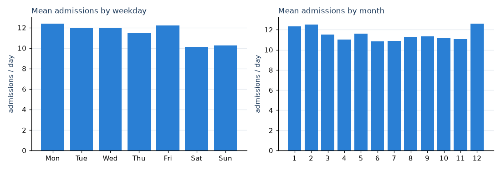
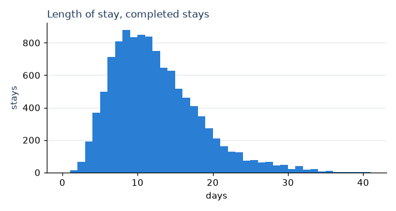
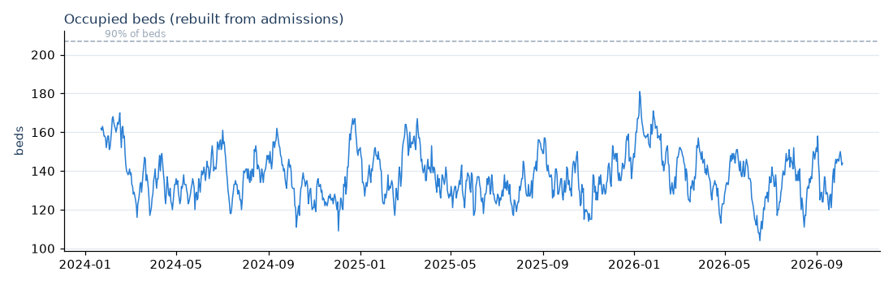
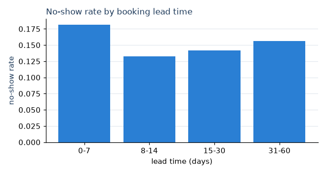

# Exploratory findings

Generated by `data/eda_findings.py` from `data/synthetic`; do not edit by hand. All data is synthetic. Statistics exclude the simulator warm-up (before 2024-01-22). The descriptive EDA stage (`run_portfolio.py --exploratory`) writes further charts to `data/eda/`.

## Patients and case mix

- **Age:** median 52, 10th-90th percentile 22-81. Gender split: Female 49.3%, Male 47.9%, Other 2.8%.
- **Departments:** General Medicine takes 47.5% of admissions; the other eight departments take 3-11% each.
- **Age is not tied to department** in this generator (Pediatrics patients span all ages), so no age-based ward rule is used in bed allocation.

| Severity | Share of admissions | ICU required |
|---|---|---|
| Low | 24.6% | 5.8% |
| Moderate | 39.7% | 6.7% |
| High | 27.6% | 8.7% |
| Critical | 8.1% | 11.3% |

## Admissions

Window: 2024-01-22 to 2026-10-05 (988 days after the warm-up), 11,344 admissions.

- **Close to Poisson.** Mean 11.48 per day, variance 12.05, dispersion (variance / mean) **1.05**. Lag-1 autocorrelation 0.02, lag-7 0.07.
- **Weekday effect: present.** Kruskal-Wallis p = 0.000; weekend / weekday ratio 0.85.
- **Monthly seasonality: present.** Kruskal-Wallis p = 0.0103; monthly means range 10.83-12.58. The generator's `seasonal_multiplier` correlates with daily admissions at r = 0.15.
- **Trend:** -0.19 admissions/day per year (p = 0.179).

**Modelling consequence.** The weekday and monthly effects are real but small: the weekday means span 2.3 admissions/day against a daily standard deviation of 3.5, and day-to-day autocorrelation is weak. The learned models get weekday and calendar features and the baselines include same-weekday-last-week, yet the 28-day moving average still has the lowest 30-day backtest error, so it is published (see MODEL_METRICS.md). Intervals use backtest errors rather than a Poisson assumption.

## Length of stay

11,200 completed stays. LOS differs from discharge minus admission date in 0 of them. In-progress stays are excluded from training, which is the censoring rule.

| Severity | Stays | Mean LOS (days) | Median | 90th percentile |
|---|---|---|---|---|
| Low | 2763 | 7.3 | 7 | 11 |
| Moderate | 4462 | 10.5 | 10 | 15 |
| High | 3077 | 14.9 | 15 | 20 |
| Critical | 898 | 22.9 | 23 | 31 |

- **ICU stays** have median LOS 16 days vs 11 otherwise.
- **Comorbidity count** correlates with LOS at Spearman rho = 0.40.
- **Department medians** range 10-15 days.

**Modelling consequence.** Severity and department explain part of LOS, so the baseline is a department x severity mean. XGBoost adds comorbidity, procedure and admission-type features known at admission, and it beats that baseline on rolling holdout windows.

## Occupancy and capacity pressure

- **Occupied beds** (census rebuilt from stays): mean 137 of 230 (59.8%), peak 181 (78.7%).
- **Days at or above 90% of beds:** 0; at or above 95%: 0. The forecast's 90%/95% alert thresholds are therefore untestable on this history, which MODEL_METRICS.md reports.
- **ICU census:** mean 14.1, peak 20 of 20 ICU beds (159 days within the 2-bed reserve).
- **Day-to-day persistence:** lag-1 autocorrelation of the census 0.92. Occupancy is a slowly changing stock, so recent values carry information; the Ridge model beats every naive baseline on it.

## Staffing

The historical shift roster was generated independently of the ward census:

| Department | Mean census | Nurses needed at 1:4 | Rostered nurses, least-staffed shift | Days with an empty nurse shift |
|---|---|---|---|---|
| Cardiology | 11 | 2.7 | 1.2 | 21% |
| Emergency | 7 | 1.7 | 0.8 | 37% |
| General Medicine | 62 | 15.5 | 0.8 | 39% |
| ICU | 14 | 3.5 | 1.8 | 9% |
| Neurology | 7 | 1.8 | 1.3 | 22% |
| Oncology | 4 | 1.0 | 0.8 | 37% |
| Orthopedics | 8 | 2.0 | 1.2 | 17% |
| Pediatrics | 11 | 2.8 | 0.7 | 41% |
| Surgery | 14 | 3.4 | 1.3 | 14% |

**Modelling consequence.** The roster cannot serve as a hard staffing limit; it would reject most admissions. Planning derives required staff from projected census at 1 nurse : 4 beds. The request-level bed replay reports rostered-staffing exceedances instead of enforcing them.

## Appointments and no-shows

- **Volume:** 117,347 appointments, 119 per day on average (range 80-154).
- **No-show rate:** 15.1% overall; weekday rates range 14.5%-15.9%.
- **Reminders:** 14.1% with a reminder vs 19.8% without (chi-square p = 2.1e-91).

| Lead time (days) | Appointments | No-show rate |
|---|---|---|
| 0-7 | 16,174 | 18.1% |
| 8-14 | 18,523 | 13.3% |
| 15-30 | 42,474 | 14.2% |
| 31-60 | 40,176 | 15.6% |

**Modelling consequence.** Lead time and reminders are known before the appointment and carry signal, so the no-show model uses them. `attended` and `no_show` are outcomes and are excluded (see tests/test_leakage_audit.py). The label is imbalanced, so models are compared on Brier score and PR-AUC rather than accuracy.
