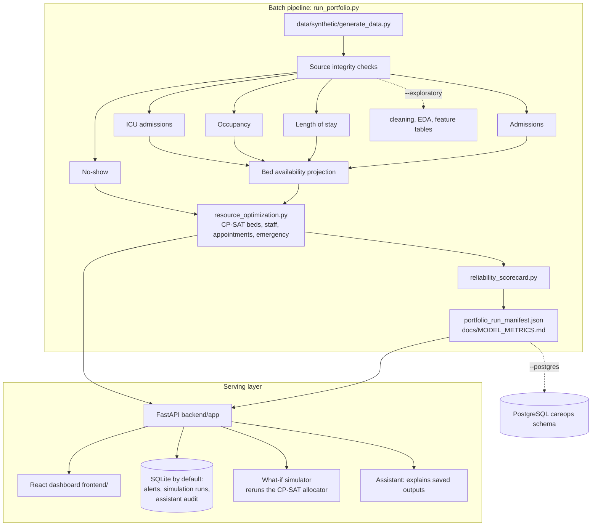

# CareOps-AI Architecture

CareOps-AI has two halves: a **batch pipeline** that generates synthetic data,
trains and backtests forecasts, and runs the OR-Tools planner, writing files;
and a **serving layer** (FastAPI + React) that reads those files. The API does
not train models or generate forecasts on request.

## Components

| Component | Where | What it does |
|---|---|---|
| Synthetic generator | `data/synthetic/generate_data.py` | Seeded patients, admissions, beds, staff, shifts, appointments and daily operations up to the scenario cutoff. The hospital opens empty on 2024-01-01; the first 21 days are warm-up and are excluded from modelling (`ml/scenario_config.py`). |
| Forecasts | `ml/` | Admissions, occupancy, ICU admissions, LOS, no-show. Admissions and occupancy are chosen by a 30-day rolling-origin backtest against naive baselines (`ml/forecast_evaluation.py`); published counts are whole numbers (`ml/count_outputs.py`). |
| Planner | `optimization/resource_optimization.py` | Bed projection, CP-SAT bed allocation, staff scheduling, appointment reassignment, emergency/ICU capacity, scenario surge capacity, input audit. |
| Scorecard and manifest | `reliability_scorecard.py`, `run_portfolio.py` | Section scores from evidence, capacity gates, run status. The run exits nonzero if any gate fails. |
| API | `backend/app/` | Serves saved CSV/JSON outputs; persists alerts, simulation runs and assistant audit records through SQLAlchemy (SQLite unless `CAREOPS_DATABASE_URL` is set). |
| What-if simulator | `backend/app/services/simulation_service.py` | Re-solves the bed allocator on adjusted saved inputs; see [simulation.md](simulation.md). |
| Assistant | `backend/app/services/ai_assistant.py` | Explains saved outputs; OpenAI, local Ollama, or a rules-based demo mode. |
| Dashboard | `frontend/` | React + TypeScript pages over the API. |
| PostgreSQL handoff | `optimization/postgresql_integration.py` | Optional: `run_portfolio.py --postgres` loads one run into the `careops` schema in a single transaction. |

## Limitations

All data is synthetic. This is an operations decision-support prototype, not a
clinical system, and none of its outputs are live staffing or placement orders.
